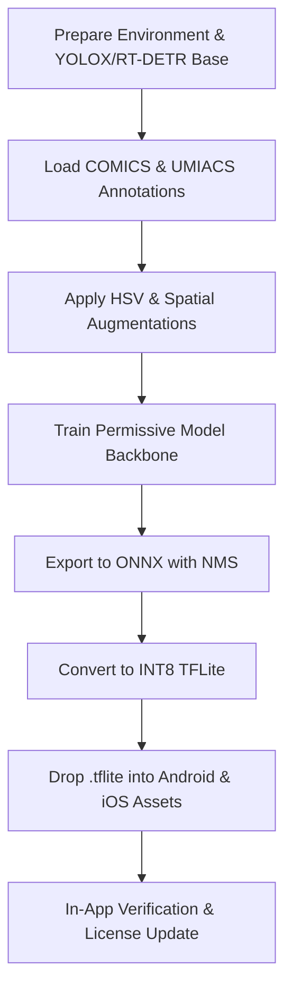

# Technical Handoff Plan: Replacement Permissive Panel Detector Model

This document outlines the technical design, dataset requirements, candidate architectures, training workflow, and deployment steps for replacing the bundled `manga_panel_detector_int8.tflite` model with a fully permissively licensed (Apache-2.0 / MIT) panel detection model.

---

## 1. Context & Motivation

### Current Model & License Issue
- **Current Model File:** `app/src/main/assets/manga_panel_detector_int8.tflite` (Android) and `iosApp/Sources/manga_panel_detector_int8.tflite` (iOS).
- **Provenance:** Fine-tuned from [`leoxs22/manga-panel-detector-yolo26n`](https://huggingface.co/leoxs22/manga-panel-detector-yolo26n) using Ultralytics YOLO (`yolov8n` / `yolo11n`).
- **License Conflict:** Ultralytics YOLO software and pretrained checkpoints carry the **GNU AGPL-3.0** license. The upstream HuggingFace repository updated its license from Apache-2.0 to **AGPL-3.0**.
- **Goal:** Replace this model with a model built on a permissively licensed base architecture (Apache-2.0 / MIT) trained on public domain / permissively licensed datasets (e.g., COMICS), completely eliminating AGPL-3.0 copyleft obligations and dataset restrictions.

---

## 2. Target Interface Specification (Zero Code Changes)

To ensure seamless integration with zero modifications to the application code, the replacement `.tflite` model MUST adhere to the existing input/output tensor specification consumed by the shared Kotlin and Swift decoders (`YoloPanelDecoder` in `:shared` and `LiteRTPanelDetector.swift` on iOS):

| Parameter | Specification | Notes |
|---|---|---|
| **Input Tensor** | `[1, 640, 640, 3]` float32 (or int8 quantized) | RGB normalized `0.0 - 1.0` or `0 - 255` |
| **Output Tensor** | `[1, N, 6]` float32 end-to-end | NMS post-processed detections |
| **Bounding Box Format** | `[x1, y1, x2, y2, score, class_id]` | Normalized pixel or 0..1 bounding box coordinates |
| **Class Mapping** | `0` = Panel, `1` = Text Balloon | `YoloPanelDecoder` filters `class == 0` for panels |

Because the runtime decoder is agnostic to the underlying neural network backbone, replacing the `.tflite` asset with a model matching this tensor signature requires **zero changes** to Android or iOS app source code.

---

## 3. Approved Permissive Candidate Architectures

The replacement model must be built using an architecture and base weights released under a permissive open-source license (**Apache-2.0** or **MIT**):

### Candidate A: YOLOX-Nano / Small (Recommended)
- **License:** Apache-2.0 (Megvii)
- **Repository:** https://github.com/Megvii-BaseDetection/YOLOX
- **Pros:** Anchor-free architecture, highly optimized for mobile CPU/NPU inference, straightforward ONNX $\rightarrow$ TFLite conversion pipeline with end-to-end NMS export.
- **Estimated Size:** ~3–8 MB (int8 quantized).

### Candidate B: RT-DETR-Nano / Small
- **License:** Apache-2.0 (Baidu / PaddleDetection)
- **Repository:** https://github.com/lylyli/RT-DETR
- **Pros:** Real-time Detection Transformer with built-in end-to-end prediction (no NMS required), strong global context understanding for complex comic page layouts.
- **Estimated Size:** ~8–12 MB.

### Candidate C: EfficientDet-Lite / MobileNetV3-SSD
- **License:** Apache-2.0 (Google TensorFlow / LiteRT Model Maker)
- **Pros:** Native TFLite export via Google TensorFlow Lite Model Maker with built-in INT8 quantization and metadata.
- **Estimated Size:** ~2–5 MB.

---

## 4. Dataset Strategy & Licensing

### Included Permissive Datasets
1. **COMICS Dataset:** Public domain / permissively licensed panel annotation dataset (~440+ pages in `training/data/panels_annotations.zip` and full COMICS dataset).
2. **UMIACS Dataset:** Public domain comic page panel annotations.
3. **Synthetic / Public Domain Comic Scans:** Open-access public domain comic scans annotated using bounding-box labeling.

### Excluded Datasets
- **Manga109-s:** Excluded from the replacement training run to avoid research user-agreement requirements, non-commercial usage ambiguities, or dataset access constraints.

### Data Augmentation Pipeline
To bridge the visual gap between black-and-white manga grids and full-color Western comics without relying on B&W-only datasets:
- **Color Jitter / HSV Perturbation:** Heavy hue, saturation, and value augmentations (`hsv_s=0.7`, `hsv_v=0.4`) to simulate greyscale/B&W manga tones from color training pages.
- **Spatial Transforms:** Multi-scale resizing, slight rotations (`±2°`), shear, and translations.

---

## 5. Step-by-Step Training & Deployment Execution Plan



### Step 1: Environment Setup
```bash
cd training
python3 -m venv venv && source venv/bin/activate
pip install yolox onnx onnx2tf tensorflow
```

### Step 2: Prepare Annotation Dataset
Convert COMICS and UMIACS annotations into the target training format:
```bash
python scripts/comics_to_yolo.py --src data/peek/panels --out dataset
```

### Step 3: Train Permissive Backbone
Execute training script using YOLOX-Nano or RT-DETR base weights:
```bash
python scripts/train_permissive.py --dataset dataset --arch yolox-nano --epochs 100
```

### Step 4: Export to TFLite (`[1, N, 6]`)
Export the best checkpoint to `.tflite` with embedded NMS post-processing:
```bash
python scripts/export_permissive_tflite.py \
  --weights runs/detect/permissive_panels/best.pth \
  --out manga_panel_detector_int8.tflite
```

### Step 5: Replace App Model Assets
Copy the generated `.tflite` file to Android and iOS asset locations:
```bash
cp manga_panel_detector_int8.tflite ../app/src/main/assets/manga_panel_detector_int8.tflite
cp manga_panel_detector_int8.tflite ../iosApp/Sources/manga_panel_detector_int8.tflite
```

### Step 6: On-Device Verification
1. Build and run Android (`./gradlew :app:assembleDebug`) and iOS app.
2. Enable debug overlay in reader to visualize detected panel bounding boxes on test CBZ/CBR files.
3. Confirm panel detection speed and memory usage meet target (< 50ms per page on device CPU/GPU).

### Step 7: Update Compliance Documentation
Update `THIRD_PARTY_NOTICES.md` and `RELEASE_COMPLIANCE.md` to declare the model asset as **Apache-2.0** licensed and derived from public domain training data.

---

## 6. Summary Checklist

- [ ] Select candidate architecture (YOLOX-Nano recommended).
- [ ] Prepare COMICS / public domain annotation dataset in `training/dataset/`.
- [ ] Train permissive model backbone using heavy HSV/color augmentation.
- [ ] Export end-to-end `.tflite` matching `[1, 640, 640, 3]` input and `[1, N, 6]` output.
- [ ] Verify on-device panel detection on Android & iOS.
- [ ] Update `THIRD_PARTY_NOTICES.md` to reflect Apache-2.0 model licensing.
